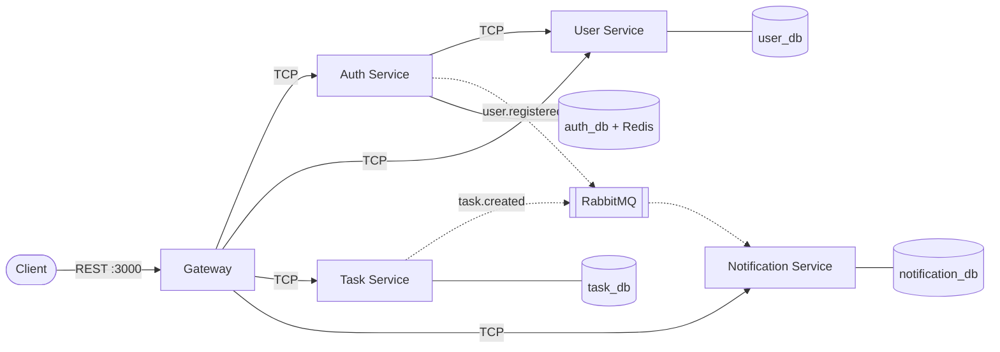

# Task Management — Microservices với NestJS

Hệ thống quản lý công việc viết theo kiến trúc microservices bằng **NestJS monorepo**: đăng ký, đăng nhập bằng JWT, quản lý task cá nhân, phân quyền ADMIN và thông báo bất đồng bộ qua RabbitMQ. Đây là dự án học tập cho Career Up Program.

- [Kiến trúc chi tiết và các quyết định thiết kế](docs/architecture.md)
- [Kịch bản demo](docs/demo.md)
- [Lộ trình (TODO)](TODO.md)

## Tính năng

- **Xác thực:**
  - Đăng ký và đăng nhập, mật khẩu hash bằng argon2.
  - Access token JWT 15 phút; refresh token 7 ngày, xoay vòng mỗi lần dùng và thu hồi khi logout (lưu ở Redis).
  - Chống dò mật khẩu bằng rate limit.
- **Task:** CRUD có phân trang và lọc theo trạng thái; mỗi người chỉ thấy và sửa được task của mình.
- **Phân quyền:** role `USER` / `ADMIN`; admin xem danh sách user, đổi role, khoá tài khoản.
- **Thông báo:** đăng ký và tạo task phát event qua RabbitMQ; Notification Service lưu lại, user xem ở `GET /notifications`.
- **Vận hành:**
  - Swagger UI ở `/api`, health check ở `/health`.
  - Lỗi trả về theo một dạng thống nhất.
  - Chạy cả hệ thống bằng một lệnh Docker Compose.
  - CI chạy unit test, e2e và smoke test trên Docker.

## Kiến trúc



| App                    | Cổng                | Vai trò                                                                   |
| ---------------------- | ------------------- | ------------------------------------------------------------------------- |
| `gateway`              | HTTP 3000           | Cửa vào duy nhất: verify JWT, RBAC, rate limit, validate, Swagger, health |
| `auth-service`         | TCP 4001            | Đăng ký, đăng nhập, cấp và thu hồi token                                  |
| `user-service`         | TCP 4002            | Hồ sơ user, role, trạng thái khoá                                         |
| `task-service`         | TCP 4003            | CRUD task theo chủ sở hữu                                                 |
| `notification-service` | TCP 4004 + RabbitMQ | Nhận event, lưu và trả thông báo                                          |

**Công nghệ:**

- NestJS 10 (monorepo, `@nestjs/microservices`)
- Prisma + PostgreSQL 16 (mỗi service một database)
- Redis, RabbitMQ
- class-validator, Swagger (`@nestjs/swagger`)
- Jest + Supertest
- Docker Compose, GitHub Actions

Thư viện dùng chung `@app/common` (`libs/common`) chứa message pattern, DTO, dạng lỗi và cấu hình dùng chung giữa các service.

## Chạy nhanh bằng Docker

Cách nhanh nhất để thấy hệ thống chạy. Chỉ cần **Docker Desktop** (hoặc Docker Engine + Compose v2) và **Node.js 22.9+**; không cần `npm install`, Node chỉ dùng để tạo `.env` và chạy script kiểm tra.

```bash
git clone https://github.com/ChuongDuc/microservice-training.git
cd microservice-training
npm run env:init                              # tạo .env, sinh sẵn JWT secret ngẫu nhiên
docker compose --profile app up -d --build    # lần đầu mất vài phút để build image
```

Lệnh `up` chờ tới khi các service bên trong đã `healthy` rồi mới bật Gateway. Sau đó:

- Swagger UI (xem và gọi thử API): http://localhost:3000/api
- Trạng thái hệ thống: http://localhost:3000/health
- RabbitMQ: http://localhost:15672 (guest/guest)

Kiểm tra bằng API thật:

```bash
npm run smoke:docker   # nhanh: health, đăng ký, đăng nhập, thông báo (CI cũng chạy)
npm run demo           # đủ kịch bản demo: task, quyền sở hữu, admin, token, rate limit
```

Tắt: `docker compose --profile app down` (thêm `-v` để xoá cả dữ liệu).

## Chạy ở chế độ phát triển

Hạ tầng (Postgres, Redis, RabbitMQ) chạy trong Docker, các app chạy trực tiếp bằng Node với hot reload. Không chạy song song với các app trong Docker: chúng dùng chung cổng 3000.

### Yêu cầu

- Node.js 22.9+ (kèm npm; các script dùng `node --env-file-if-exists`, có từ 22.9)
- Docker + Docker Compose

### 1. Cài dependencies

```bash
npm install
```

### 2. Tạo file môi trường

```bash
npm run env:init
```

Lệnh này copy `.env.example` thành `.env` và sinh ngẫu nhiên `JWT_ACCESS_SECRET` / `JWT_REFRESH_SECRET`. Nếu `.env` đã có thì giữ nguyên. Các giá trị khác mặc định đã khớp với `docker-compose.yml`.

Muốn tự làm: `cp .env.example .env`, rồi thay hai secret JWT. Gateway và Auth không khởi động nếu secret còn là giá trị mẫu, ngắn hơn 32 ký tự hoặc hai secret trùng nhau. Tạo mỗi secret bằng:

```bash
node -e "console.log(require('crypto').randomBytes(32).toString('hex'))"
```

### 3. Bật hạ tầng (Postgres, Redis, RabbitMQ)

```bash
docker compose up -d
docker compose ps        # đợi cả 3 container ở trạng thái healthy
```

Lần chạy đầu, script `docker/postgres/init-multiple-dbs.sh` tự tạo 4 database `auth_db`, `user_db`, `task_db`, `notification_db`. Volume Postgres tạo từ trước khi có `notification_db` thì script không chạy lại: `prisma:notification:migrate` (`migrate dev`) tự tạo database còn thiếu.
Giao diện quản trị RabbitMQ: http://localhost:15672 (guest/guest).

Tắt hạ tầng: `docker compose down` (thêm `-v` nếu muốn xoá luôn dữ liệu).

### 4. Prisma: generate client + migrate DB

Mỗi service có Prisma schema riêng, nên chạy cho từng service:

```bash
# User Service (user_db)
npm run prisma:user:generate
npm run prisma:user:migrate

# Auth Service (auth_db)
npm run prisma:auth:generate
npm run prisma:auth:migrate

# Task Service (task_db)
npm run prisma:task:generate
npm run prisma:task:migrate

# Notification Service (notification_db) — .env cần NOTIFICATION_DATABASE_URL (xem .env.example)
npm run prisma:notification:generate
npm run prisma:notification:migrate
```

Client được sinh vào `apps/<service>/generated/prisma`. `migrate` chạy `prisma migrate dev`: áp dụng migration có sẵn và tự gọi lại `generate`.

Lệnh Prisma khác (studio, reset...) thì gọi trực tiếp và đặt `--schema` **sau** tên lệnh:

```bash
npx prisma studio --schema=apps/user-service/prisma/schema.prisma
npx prisma migrate reset --schema=apps/user-service/prisma/schema.prisma
```

### 5. Chạy service (chế độ watch)

Mỗi service là một process riêng, mở mỗi service một terminal:

```bash
npm run start:dev user-service    # TCP, cổng USER_SERVICE_PORT (mặc định 4002)
npm run start:dev auth-service    # TCP, cổng AUTH_SERVICE_PORT (mặc định 4001)
npm run start:dev task-service    # TCP, cổng TASK_SERVICE_PORT (mặc định 4003)
npm run start:dev gateway         # HTTP, cổng GATEWAY_PORT (mặc định 3000), cần auth-service + user-service (+ task-service cho /tasks)
npm run start:dev notification-service  # RabbitMQ (queue RABBITMQ_QUEUE) + TCP, cổng NOTIFICATION_SERVICE_PORT (mặc định 4004)
```

> `gateway` là cửa vào HTTP duy nhất (cổng `GATEWAY_PORT`), có các route `POST /auth/register`, `/auth/login`, `/auth/refresh`, `/auth/logout` và forward xuống Auth Service qua TCP. Mọi route khác cần header `Authorization: Bearer <accessToken>` (Gateway tự verify bằng `JWT_ACCESS_SECRET`, thiếu/sai token -> 401); `GET /auth/me` trả `userId` + `role` của token; `GET /users/me` trả hồ sơ từ User Service (Gateway truyền danh tính `{ user: { userId, role } }` xuống trong payload). `auth-service`/`user-service`/`task-service`/`notification-service` mặc định chỉ nghe `127.0.0.1` (`*_SERVICE_BIND_HOST`) vì tin danh tính trong payload — chỉ Gateway được gọi tới. `task-service` nhận `task.create/find_all/find_one/update/delete` qua TCP.

Mở http://localhost:3000/api (Swagger UI) để gọi thử, hoặc chạy `npm run demo`.

## API và cơ chế hoạt động

`notification-service` nhận event bất đồng bộ (`@EventPattern`, chỉ trên RabbitMQ) từ queue `RABBITMQ_QUEUE` (kết nối theo `RABBITMQ_USER/PASSWORD/HOST/PORT`). Event hiện có: `user.registered`, `task.created` (tên + payload ở `NOTIFICATION_EVENTS` và `libs/common/src/dto/events`). Queue `durable` + message `persistent`, ack thủ công: message chỉ bị xoá khỏi queue khi xử lý xong, service tắt thì event nằm chờ trong queue. Payload sai, handler lỗi hoặc event không có handler -> message chuyển vào dead-letter queue `<queue>.dlq` (không giao lại ngay, tránh lặp vô hạn) và ghi log một lần; xem/đưa lại message trong DLQ qua giao diện quản trị RabbitMQ (shovel hoặc Move messages). Giao "ít nhất một lần": mỗi event có `eventId` (UUID) để phía nhận chống xử lý trùng.

Mỗi event thành một thông báo lưu trong `notification_db` (`user.registered` -> chào mừng user mới, `task.created` -> báo chủ task). `eventId` là UNIQUE: event giao lại không tạo thông báo trùng. Xem danh sách qua Gateway: `GET /notifications?page=&limit=` (cần access token, chỉ thông báo của người gọi, mới nhất trước) — Gateway gọi `notification.find_all` qua TCP.

Phía phát: Auth Service phát `user.registered` khi đăng ký xong (đã lưu credential), Task Service phát `task.created` sau khi tạo task — qua `NotificationPublisher` (import `NotificationsPublisherModule` từ `@app/common`, tự gắn `eventId`). Phát kiểu "bắn rồi quên": request không chờ RabbitMQ, RabbitMQ tắt thì đăng ký/tạo task vẫn thành công, event đó chỉ được ghi log lỗi (chưa có outbox để phát lại).

> Đã từng chạy `notification-service` trước khi có DLQ: queue `notifications_queue` cũ khai báo khác (thiếu dead-letter) nên RabbitMQ từ chối (`PRECONDITION_FAILED`). Xoá queue cũ một lần: `docker compose exec rabbitmq rabbitmqctl delete_queue notifications_queue`.

Chống dò mật khẩu (`@nestjs/throttler`), vượt ngưỡng -> 429 kèm header `Retry-After` (giây):

- `POST /auth/login`: tối đa 5 lần vào một email từ một IP (`LOGIN_THROTTLE_LIMIT`) và 20 lần mỗi IP cho mọi email (`LOGIN_THROTTLE_IP_LIMIT`), mỗi 60 giây (`LOGIN_THROTTLE_TTL_MS`). Người khác dùng chung IP (văn phòng, NAT) không bị chặn theo khi một tài khoản bị khoá tạm.
- `POST /auth/register`: tối đa 20 lần mỗi IP (chặn dò email đã đăng ký, tạo tài khoản rác).
- Bộ đếm nằm trong bộ nhớ Gateway (nhiều instance thì mỗi instance đếm riêng). Gateway đứng sau reverse proxy phải đặt `TRUST_PROXY` (số proxy phía trước hoặc IP/subnet proxy), nếu không mọi client có chung IP của proxy và chung bộ đếm.

Phân quyền theo role: gắn `@Roles('ADMIN')` ở controller hoặc route (gắn ở cả hai thì route thắng), `RolesGuard` toàn cục chạy sau `JwtAuthGuard` và trả 403 khi role trong access token không nằm trong danh sách. Route có `@Roles()` luôn cần token, kể cả khi gắn thêm `@Public()`. Role đọc từ token (không hỏi User Service), nên đổi role chỉ có hiệu lực khi người đó lấy access token mới — tối đa `JWT_ACCESS_EXPIRES_IN` (15 phút).

**Tài liệu API (Swagger).** Gateway chạy thì mở http://localhost:3000/api xem toàn bộ REST API và gọi thử ngay trên trang (JSON OpenAPI: `/api-json`). Route có ổ khoá cần token: gọi `POST /auth/login` -> copy `accessToken` -> bấm **Authorize** và dán vào. Tắt bằng `SWAGGER_ENABLED=false`.

- Schema body/query sinh từ DTO trong `@app/common` nhờ CLI plugin `@nestjs/swagger` (khai báo ở `nest-cli.json`, project `gateway`): đọc kiểu TypeScript, rule class-validator (độ dài, enum, min/max...) và comment JSDoc — không phải gắn `@ApiProperty` vào từng field. DTO dẫn xuất dùng `PartialType` / `OmitType` của `@nestjs/swagger` (cùng hành vi với `@nestjs/mapped-types` nhưng giữ metadata tài liệu).
- Controller mới: gắn `@ApiTags`, `@ApiOperation({ summary })` cho từng route và `@ApiBearerAuth(BEARER_AUTH)` nếu cần token (route `@Public()` thì không).
- E2E `apps/gateway/test/swagger.e2e-spec.ts` kiểm tra `/api` và nội dung tài liệu (đủ route, khoá đúng route, schema DTO); ts-jest chạy cùng plugin qua `swagger-plugin-transformer.js`.

**Health check.** Biết service nào sống/chết qua Gateway (công khai, không cần token):

- `GET /health/live`: Gateway còn sống — luôn `200 { "status": "up" }`, không gọi service nào.
- `GET /health`: Gateway gửi `health.check` (`HEALTH_PATTERNS.CHECK`) qua TCP tới cả 4 service song song (chờ tối đa 5s mỗi service); mỗi service tự kiểm tra phụ thuộc của nó (tối đa 3s mỗi phụ thuộc): DB (`SELECT 1`) cho cả 4, Redis cho Auth, RabbitMQ cho Notification (queue thông báo phải có consumer). `200` khi mọi thành phần `up`, `503` khi có thành phần `down`:

```json
{
  "status": "down",
  "services": {
    "gateway": { "status": "up" },
    "auth-service": {
      "status": "up",
      "dependencies": { "database": "up", "redis": "up" }
    },
    "user-service": { "status": "down" },
    "task-service": { "status": "up", "dependencies": { "database": "up" } },
    "notification-service": {
      "status": "up",
      "dependencies": { "database": "up", "rabbitmq": "down" }
    }
  }
}
```

Service không trả lời (chết, sai cổng, quá hạn) chỉ có `status: down`. Kết quả chỉ có `up`/`down`; lý do lỗi (host, cổng, thông báo của driver) ghi vào log của service/Gateway, không trả ra ngoài. Service mới: thêm controller `@MessagePattern(HEALTH_PATTERNS.CHECK)` gọi `checkDependencies({ ... })` của `@app/common` và đăng ký client của nó trong `HealthService` của Gateway.

Route `/tasks` ở Gateway (cần access token, chỉ thao tác trên task của người gọi — task của người khác trả 404):

| Method   | Route                         | Mô tả                                                                                                |
| -------- | ----------------------------- | ---------------------------------------------------------------------------------------------------- |
| `POST`   | `/tasks`                      | Tạo task (`title` bắt buộc; `description`, `status`, `priority`, `dueDate` ISO 8601 tuỳ chọn) -> 201 |
| `GET`    | `/tasks?page=&limit=&status=` | Danh sách task của người gọi, mới nhất trước (`limit` tối đa 100)                                    |
| `GET`    | `/tasks/:id`                  | Một task                                                                                             |
| `PATCH`  | `/tasks/:id`                  | Sửa một phần (`description`/`dueDate: null` để xoá giá trị)                                          |
| `DELETE` | `/tasks/:id`                  | Xoá, trả về task vừa xoá                                                                             |

Route `/admin/users` (chỉ ADMIN — `@Roles('ADMIN')`, user thường -> 403; User Service cũng kiểm tra lại role):

| Method  | Route                                             | Mô tả                                                                                  |
| ------- | ------------------------------------------------- | -------------------------------------------------------------------------------------- |
| `GET`   | `/admin/users?page=&limit=&search=&role=&status=` | Danh sách user, `search` tìm theo email hoặc tên hiển thị (không phân biệt hoa thường) |
| `PATCH` | `/admin/users/:id/role`                           | Đổi role: `{ "role": ... }`, giá trị `USER` hoặc `ADMIN`                               |
| `PATCH` | `/admin/users/:id/status`                         | Khoá / mở khoá: `{ "status": ... }`, giá trị `ACTIVE` hoặc `BLOCKED`                   |

Admin không tự đổi role hay tự khoá chính mình được (400). User bị khoá không đăng nhập hay refresh được nữa (403); role mới và trạng thái khoá áp dụng cho access token cấp sau đó, token đang dùng giữ nguyên tới khi hết hạn. ADMIN đầu tiên cần đặt trực tiếp trong DB: `UPDATE "User" SET role = 'ADMIN' WHERE email = '...';` (user_db).

**Dạng lỗi thống nhất.** Mọi lỗi (từ Gateway hay từ service phía trong) trả về cùng một dạng:

```json
{
  "statusCode": 400,
  "message": "Validation failed",
  "errors": [
    {
      "field": "title",
      "constraints": { "isNotEmpty": "title should not be empty" }
    }
  ]
}
```

`errors` chỉ có với lỗi validate. Body/query được validate ngay ở Gateway (`ValidationPipe` toàn cục: bỏ qua field không khai báo trong DTO, gửi field lạ -> 400), service phía trong validate lại payload. Lỗi không lường trước trả `500 Internal server error` và chỉ ghi chi tiết vào log.

Build một app: `npx nest build <app>` (output nằm trong `dist/apps/<app>`). Sau khi build cả 5 app, `npm run smoke:start` chạy thử từng bản build (`node dist/apps/<app>/main.js`) tới khi nghe được cổng — riêng `notification-service` chờ cả cổng TCP lẫn queue của nó có consumer, nên cần RabbitMQ (và Postgres) đang chạy (CI cũng chạy bước này).

## Docker: chi tiết

Một lệnh bật hạ tầng, chạy migration và cả 5 app trong container (xem [Chạy nhanh bằng Docker](#chạy-nhanh-bằng-docker)). Compose chỉ cần `.env` có `JWT_ACCESS_SECRET` / `JWT_REFRESH_SECRET` (`npm run env:init`):

```bash
docker compose --profile app up -d --build
docker compose --profile app ps     # migrate ở trạng thái Exited (0), các app Up (healthy)
```

API ở http://localhost:3000 (Gateway — app duy nhất publish cổng). Xem log: `docker compose logs -f gateway`. Tắt: `docker compose --profile app down`.

Kiểm tra nhanh cả hệ thống: `npm run smoke:docker` gọi API thật qua Gateway (chờ `GET /health` trả 200 -> đăng ký một user `smoke-<uuid>@test.com` -> đăng nhập -> `GET /users/me` -> chờ thông báo chào mừng ở `GET /notifications`). CI chạy cùng kịch bản này trong job `Docker`.

- Các app nằm trong profile `app`: `docker compose up -d` (không có `--profile app`) vẫn chỉ bật hạ tầng để chạy app bằng `npm run start:dev` như phần trên. Đang chạy app trong container thì cổng 3000 đã bị Gateway container chiếm.
- `Dockerfile` dùng chung cho cả 5 app, chọn app bằng build arg: `docker build --build-arg APP=task-service -t tm-task-service .`. Stage `build` generate Prisma client trong container (query engine cho Linux) và build cả 5 app một lần, các image dùng lại cache của nhau; image chạy (`runtime`) chỉ có dependencies chạy thật + bản build của một app, chạy bằng user `node`.
- Mỗi app có Docker healthcheck (xem cột STATUS của `ps`): service TCP chạy `scripts/tcp-healthcheck.js <cổng>` (gửi `health.check`, healthy khi service và phụ thuộc đều `up`), Gateway gọi `GET /health/live`. Gateway (và Auth, vì gọi User Service) chỉ khởi động khi các service nó cần đã healthy. Trạng thái toàn hệ thống: `curl -i http://localhost:3000/health`.
- Service `migrate` chạy `prisma migrate deploy` cho 4 database rồi thoát; các service có DB chỉ khởi động sau khi migrate thành công.
- Trong container, app đọc cấu hình từ biến môi trường do `docker-compose.yml` truyền vào (hostname là tên service: `postgres`, `redis`, `rabbitmq`, `user-service`...), không đọc file `.env` (file này chỉ dùng để compose điền giá trị như `JWT_*`, mật khẩu Postgres/RabbitMQ).

## Test

```bash
# Unit test (mọi file *.spec.ts trong apps/ và libs/)
npm test

# E2E User Service: bật User Service thật qua TCP (cổng 4102) và gọi bằng ClientProxy.
# Cần Postgres đang chạy và đã chạy npm run prisma:user:migrate.
npm run test:e2e:user

# E2E Auth Service (cổng 4101/4102) và Task Service (cổng 4103): service thật qua TCP.
# Cần Postgres đã migrate (auth_db, user_db, task_db) và Redis cho Auth.
npm run test:e2e:auth
npm run test:e2e:task

# E2E Gateway: bật User + Auth Service thật (TCP, cổng 4202/4201) và Gateway, gọi REST /auth/*;
# bật Task Service thật (TCP, cổng 4213) và gọi REST /tasks.
# Bật Notification Service thật (TCP 4224) và gọi REST /notifications (task.created -> thông báo).
# GET /health: chỉ bật User Service (TCP 4292), các service khác phải được báo down.
# Cần Postgres (đã migrate user_db + auth_db + task_db + notification_db), Redis và RabbitMQ.
npm run test:e2e:gateway

# Các e2e Auth/Task/Gateway phát event vào queue RabbitMQ riêng của từng file test (xoá khi
# xong), nên cũng cần RabbitMQ đang chạy.

# E2E Notification Service: bật service thật, phát event qua RabbitMQ (queue riêng cho
# mỗi lần chạy, xoá khi xong) và gọi notification.find_all qua TCP (cổng 4104).
# Cần RabbitMQ + Postgres (đã migrate notification_db).
npm run test:e2e:notification
```

## Cấu trúc thư mục

```
apps/
  gateway/              # API Gateway (HTTP): controller REST, guard JWT/role, Swagger, health
  auth-service/         # Đăng ký, đăng nhập, JWT, refresh token (auth_db + Redis)
  user-service/         # Hồ sơ user, role, khoá tài khoản (user_db)
  task-service/         # CRUD task theo chủ sở hữu (task_db)
  notification-service/ # Nhận event qua RabbitMQ, lưu + trả thông báo (notification_db)
  <app>/prisma/         # Prisma schema + migration riêng của từng service
  <app>/test/           # E2E của từng app
libs/
  common/               # @app/common: message pattern, DTO, lỗi, RabbitMQ, health
docs/                   # Kiến trúc, kịch bản demo
scripts/                # env:init, demo, smoke test, Docker healthcheck
test/e2e/               # Helper dùng chung cho e2e
docker/                 # Script khởi tạo Postgres (tạo 4 database)
Dockerfile              # Image cho từng app (build arg APP)
docker-compose.yml      # Postgres + Redis + RabbitMQ; profile `app`: migration + 5 app
```

## Xử lý sự cố

| Triệu chứng                                                                | Nguyên nhân / cách xử lý                                                                                                                                    |
| -------------------------------------------------------------------------- | ----------------------------------------------------------------------------------------------------------------------------------------------------------- |
| `failed to connect to the docker API`                                      | Docker Desktop chưa chạy: bật Docker Desktop, chờ tới khi sẵn sàng rồi chạy lại.                                                                            |
| `migrate` thoát lỗi, log nói về `JWT_ACCESS_SECRET` / `JWT_REFRESH_SECRET` | `.env` thiếu secret hoặc còn giá trị mẫu: chạy `npm run env:init` (với `.env` mới) hoặc sửa hai dòng đó theo [bước 2](#2-tạo-file-môi-trường).              |
| Gateway/Auth chạy bằng `start:dev` thoát ngay vì JWT secret                | Như trên: secret phải dài ít nhất 32 ký tự, khác giá trị mẫu, và hai secret khác nhau.                                                                      |
| `port is already allocated` / `EADDRINUSE :3000`                           | Cổng 3000 đang bị dùng (thường là Gateway chạy cả trong Docker lẫn `start:dev`): tắt một bên, hoặc đổi `GATEWAY_PORT` trong `.env`.                         |
| `GET /health` trả 503                                                      | Xem thành phần nào `down` trong body; `docker compose --profile app ps` và `docker compose logs <service>` để xem lỗi.                                      |
| Route trả 503 "... không khả dụng"                                         | Service tương ứng chưa chạy hoặc đã chết (`start:dev` chưa bật service đó).                                                                                 |
| `PRECONDITION_FAILED` từ RabbitMQ                                          | Queue cũ tạo trước khi có dead-letter queue: `docker compose exec rabbitmq rabbitmqctl delete_queue notifications_queue`.                                   |
| `notification_db` không tồn tại                                            | Volume Postgres tạo trước khi có database này: `npm run prisma:notification:migrate` tự tạo, hoặc `docker compose down -v` để tạo lại từ đầu (mất dữ liệu). |
| 429 khi đăng ký/đăng nhập                                                  | Giới hạn theo IP trong 60 giây (`LOGIN_THROTTLE_*` trong `.env`): chờ một phút.                                                                             |
