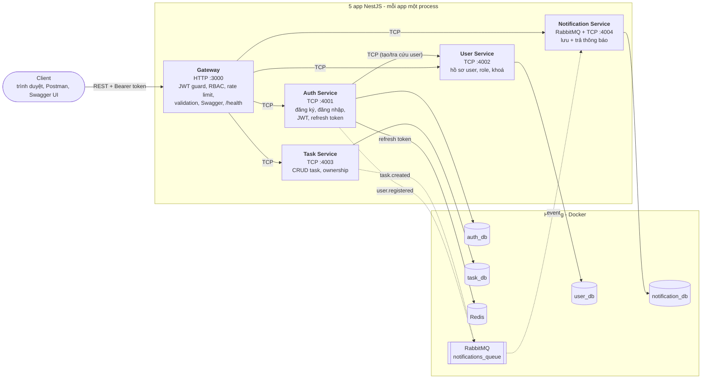
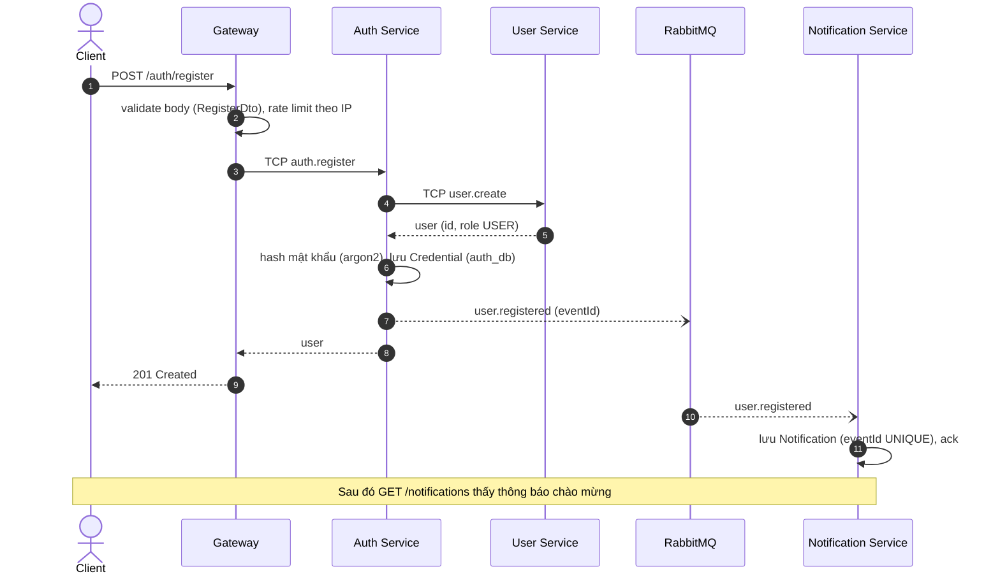
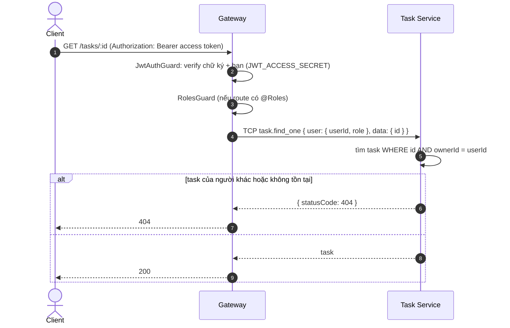

# Kiến trúc

Tài liệu này mô tả các thành phần của hệ thống, cách chúng nói chuyện với nhau và lý do của các lựa chọn thiết kế chính. Cách cài đặt và chạy: xem [README](../README.md).

## Tổng quan

Nét liền: gọi đồng bộ (request-response). Nét đứt: event bất đồng bộ.

| App                    | Giao tiếp                                | Dữ liệu                                                            | Trách nhiệm                                                                                                                       |
| ---------------------- | ---------------------------------------- | ------------------------------------------------------------------ | --------------------------------------------------------------------------------------------------------------------------------- |
| `gateway`              | HTTP `:3000` (cổng duy nhất mở ra ngoài) | —                                                                  | Cửa vào REST: verify JWT, kiểm tra role, giới hạn đăng nhập, validate body/query, chuẩn hoá lỗi, Swagger `/api`, health `/health` |
| `auth-service`         | TCP `:4001`                              | `auth_db` (Credential: email + hash argon2), Redis (refresh token) | Đăng ký, đăng nhập, cấp/xoay vòng/thu hồi token; phát `user.registered`                                                           |
| `user-service`         | TCP `:4002`                              | `user_db` (User: email, tên, role, trạng thái)                     | Hồ sơ user, danh sách cho admin, đổi role, khoá/mở khoá                                                                           |
| `task-service`         | TCP `:4003`                              | `task_db` (Task)                                                   | CRUD task, chỉ chủ task thao tác được; phát `task.created`                                                                        |
| `notification-service` | RabbitMQ (nhận event) + TCP `:4004`      | `notification_db` (Notification)                                   | Biến event thành thông báo, trả danh sách thông báo của user                                                                      |

Thư viện dùng chung `@app/common` (`libs/common`) chứa "hợp đồng" giữa các service: tên message pattern và event, DTO (validate bằng class-validator), dạng lỗi, cấu hình RabbitMQ, helper health check.

## Luồng chính

### Đăng ký: gọi đồng bộ + event bất đồng bộ

Gửi event là "bắn rồi quên": RabbitMQ chết thì đăng ký vẫn thành công, event bị mất và chỉ được ghi log (chưa có outbox).

### Request cần đăng nhập: verify token ở Gateway, truyền danh tính xuống

## Các quyết định thiết kế

**Gateway là cửa vào duy nhất.** Chỉ Gateway mở cổng ra ngoài. Các service bên trong mặc định chỉ nghe `127.0.0.1` (Docker: chỉ trong mạng nội bộ của compose) vì chúng tin danh tính `{ user }` mà Gateway truyền trong payload. Ai gọi thẳng được service bên trong thì giả được danh tính.

**Verify JWT ngay ở Gateway, không hỏi Auth Service.** Mỗi request không phải gọi thêm một lượt TCP. Đánh đổi: role mới, tài khoản bị khoá hay đã logout chỉ có hiệu lực khi access token hết hạn (15 phút). Refresh token thì luôn kiểm tra lại với Redis và User Service.

**Refresh token rotation.** Mỗi refresh token chỉ dùng được một lần (`GETDEL` trên Redis, lưu dạng hash). Token bị lộ mà kẻ gian dùng trước thì người dùng thật sẽ bị từ chối ở lần refresh kế tiếp.

**Mỗi service một database.** Bốn database logic trên một instance Postgres, mỗi service có Prisma schema, migration và client riêng. Không service nào đọc DB của service khác: cần dữ liệu thì gọi qua TCP (Auth hỏi User Service).

**TCP cho request-response, RabbitMQ cho event.**

- TCP: Gateway cần câu trả lời ngay để trả cho client.
- RabbitMQ: thông báo không cần chờ, Notification Service tắt thì event nằm trong queue chờ.

**Giao event "ít nhất một lần".**

- Queue `durable`, message `persistent`, ack thủ công sau khi lưu xong.
- Event giao lại không tạo thông báo trùng nhờ `eventId` UNIQUE.
- Event lỗi (payload sai, handler lỗi) vào dead-letter queue `<queue>.dlq` thay vì lặp vô hạn.
- Lỗi DB tạm thời được thử lại trước khi đẩy vào DLQ.

**Lỗi thống nhất.**

- Service bên trong ném `RpcException` với `{ statusCode, message, errors? }`.
- Gateway giữ nguyên mã lỗi khi trả cho client.
- Service chết hoặc quá hạn: 503. Lỗi không lường trước: 500, chỉ ghi chi tiết vào log.

**Health check hai tầng.**

- Mỗi service tự kiểm tra phụ thuộc của nó qua pattern `health.check`.
- Gateway gom kết quả vào `GET /health`: 200 khi mọi thành phần sống, 503 khi có thành phần chết.
- Docker healthcheck dùng cùng cơ chế, nên `docker compose ps` cho biết container nào không khoẻ.

## Giới hạn đã biết

- Event có thể mất khi RabbitMQ chết đúng lúc phát (chưa có transactional outbox).
- Bộ đếm rate limit nằm trong bộ nhớ Gateway: nhiều instance Gateway thì mỗi instance đếm riêng.
- Chưa có API tạo ADMIN đầu tiên (đặt trực tiếp trong `user_db`).
- Một Postgres cho cả 4 database: tách DB ở mức logic, chưa tách instance.
